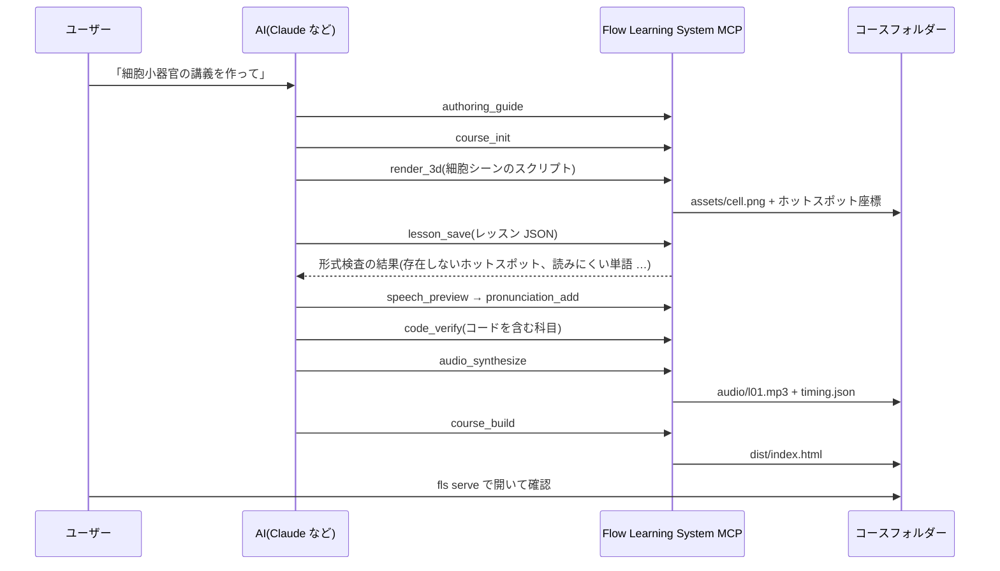

# Flow Learning System
<p align="center"><a href="README.md">English</a> · <a href="README.ko.md">한국어</a> · <b>日本語</b> · <a href="README.zh-CN.md">简体中文</a></p>

**モーショングラフィックスと TTS を活用した学習システムです。** 数学、理科、英語、生物、プログラミングなど、科目を問いません。
レッスンを JSON データで書くと **1 文が 1 シーン** になり、音声がその文を読み始めた瞬間に、
画面上のグラフ・数式・文の成分・3D 図・コードが連動して動く、単一ファイルの HTML 教材が生成されます。
AI は MCP ツールを使って教材を書き、検査し、サンプルコードを実行して確認し、Blender で 3D 図をレンダリングし、音声を収録し、ビルドします。

> 同梱の TTS(Supertonic)が現在対応している音声は韓国語と英語で、サンプルコースは韓国語で作られています。

<table>
<tr>
<td width="50%"><br><b>数学</b> · 二次関数の平行移動<br><sub>曲線がスライドして移動し、数式の変わる部分が強調されます</sub></td>
<td width="50%"><br><b>理科</b> · 斜面上の物体<br><sub>Blender のレンダリング画像の上で、重力が 2 つの成分に分かれて伸びていきます</sub></td>
</tr>
<tr>
<td><br><b>英語</b> · 受動態の作り方<br><sub>単語が位置を移動し、例文は英語の音声で読み上げます</sub></td>
<td><br><b>生物</b> · 動物細胞の構造<br><sub>3D の細胞断面を拡大しながら、細胞小器官を 1 つずつ示します</sub></td>
</tr>
</table>

<p align="center"><br><b>プログラミング</b> · C# 文法 全 17 講のうち第 7 講「配列」 — 実行中の行の強調、配列の要素の埋まり方、実行履歴の表、目次・台本の折りたたみ</p>

---

## 中心となる考え方:1 文 = 1 シーン

<p align="center"></p>

- レッスンの `say` 1 つが **1 シーン** です。シーンには、台本の文、大きく表示するキーフレーズ、その瞬間の図(グラフ、数式、文の成分、画像、コード、変数…)がまとめて含まれます。
- 音声は文ごとに個別に合成してつなぎ合わせ、**各文が何秒目に始まるか** を `timing.json` に記録します。
- プレイヤーはオーディオの現在の再生位置を毎フレーム読み取ってシーンを選びます。再生速度を変えたり途中へスキップしたりしても、画面と音声がずれません。

## サンプルコース

| 科目 | コース | シーン数 | 使われている図 | 見どころ |
|---|---|---|---|---|
| 数学 | [`examples/math-quadratic`](examples/math-quadratic) | 13 | `plot`, `math`, `tbl` | 同じ名前の曲線がシーン間で変形し、平行移動が目に見える |
| 理科 | [`examples/physics-incline`](examples/physics-incline) | 12 | `img`(3D レンダリング), `math`, `bars`, `plot` | 3D で計算した力の終点に向かって矢印が伸びる、拡大 |
| 英語 | [`examples/english-passive`](examples/english-passive) | 12 | `tokens`, 例文欄, `tbl`, `flow` | 語のかたまりが位置を移動、`{en|…}` 区間は英語音声 |
| 生物 | [`examples/biology-cell`](examples/biology-cell) | 13 | `img`(3D レンダリング), `flow`, `cards` | 細胞断面を拡大しながら、細胞小器官のラベルが移動していく |
| プログラミング | [`examples/csharp-grammar`](examples/csharp-grammar) | 321(17 講) | コード、変数、配列、スタック・キュー・辞書、コンソール | 48 個のサンプルを実際に実行し、画面の出力と照合 |

## Blender で 3D 図を入れる

<p align="center"></p>

`render_3d` ツールは、AI が書いた Blender のシーンスクリプトをウィンドウなしで実行し、Cycles でレンダリングします。
スクリプト内で `spot("名前", (x, y, z))` によって 3D 位置を指定しておくと、その点が **遠近法を反映した画像上のどこに来るか** を計算し、あわせて保存します。
レッスンではその名前を使って、ラベル、拡大の中心、矢印を指定します。

```python
# 斜面上の箱 — 重力とその 2 成分の終点を 3D ベクトルで計算
th = math.radians(30)
d = V3((math.cos(th), 0, -math.sin(th)))   # 斜面に沿って下向き
n = V3((math.sin(th), 0, math.cos(th)))    # 斜面に垂直な向き
spot("block", C)
spot("g_tip", C + V3((0, 0, -2.6)))                 # 重力 mg
spot("par_tip", C + d * 2.6 * math.sin(th))         # mg sinθ
spot("perp_tip", C - n * 2.6 * math.cos(th))        # mg cosθ
```

```json
{"img": ["assets/incline.png", {
  "spots": {"theta": {"label": "θ = 30°"}},
  "arrows": [{"from": "block", "to": "g_tip", "label": "mg", "c": "bad"},
             {"from": "block", "to": "par_tip", "label": "mg sinθ", "c": "g1"}],
  "zoom": 1.35, "focus": "block"}]}
```

矢印の先端は 3D で計算した点なので、レンダリングされた斜面と正確に一致します。シーンスクリプトは `assets/src/` に残るため、いつでも再レンダリングできます。

## 画面構成

<p align="center"></p>

| 領域 | 内容 |
|---|---|
| 左側 **目次** | 講義と小単元。折りたたみ可能で、小単元をクリックするとそのシーンへ移動 |
| 中央 **ステージ** | キーフレーズ + 左欄(コード・例文、現在の行を強調)+ 図。テーマに関係なく常に暗い画面 |
| 右側 **台本** | 画面の約 1/5。読み上げ中の文を強調し、クリックするとその文から再生。折りたたみ可能 |
| 下部 **タイムライン** | シーン単位で区切られた進行バー |

上部バーには、講義の移動、再生、シーン移動、再生速度(0.75×〜2×)だけを置いています。スマートフォンでは、目次と台本は重ねて開くドロワーになります。

## モーションのルール

<p align="center"></p>

シーンが切り替わるとき、画面上の要素を **名前(キー)で対応付けて** 動かします。アニメーションを個別に指定しなくても、データを変えるだけで動きが生まれます。

| 動き | 条件 | 例 |
|---|---|---|
| スライド | 同じ名前の要素が別の位置にあるとき | 配列のソート、ポインタ `i`、受動態での語の移動 |
| 変形 | 同じ名前の曲線・点・線の座標が変わるとき | 放物線の平行移動、幅の変化 |
| 飛来 | `from` で出発元の欄を指定したとき | `answer[(i + k) % n] = arr[i]` |
| 伸長 | 新しい矢印が現れるとき | 力の分解 |
| 拡大・移動 | 画像の `zoom`、`focus` が変わるとき | 細胞小器官を示す |
| 点滅 · 飛散 | 値だけが変わる · 消える | 変数の値、Pop |

## レッスン 1 つの解剖図

<p align="center"></p>

```json
{
  "id": 1, "group": "수학", "title": "이차함수의 평행이동",
  "ops": [
    {"op": "part", "title": "x축 방향으로 평행이동"},
    {"op": "say", "head": "{m|y = (x - 2)^2} : 오른쪽으로 2",
     "text": "x 자리에 x 빼기 2를 넣으면 그래프 전체가 오른쪽으로 2만큼 미끄러집니다.",
     "board": {"seq": [
       {"plot": [{"curves": [{"fn": "(x-2)**2", "c": "g1", "key": "p"}],
                  "points": [{"x": 2, "y": 0, "label": "꼭짓점 (2, 0)", "key": "v"}]}]},
       {"math": [["y = x^2", "y = (x - 2)^2"], {"hl": [1]}]}]}}
  ]
}
```

サンプルコースは韓国語でナレーションされ、`{en|…}` 区間は英語の音声で読み上げられます。

`say` より前の op が画面の状態を作り、`say` がその瞬間を文とともにシーンとして記録します。
22 種類の op、24 種類のウィジェット、文の記法(`{m|数式}`、`{en|English}`、`[[表記|読み方]]`)は **[レッスン作成ガイド](docs/authoring.md)**(韓国語)にまとめています。MCP の `authoring_guide` ツールも同じ内容を返します。

## ワークフロー

<p align="center"></p>



検査の各段階で検出できるもの:

- **形式検査**:存在しない op・ウィジェット、画像にないホットスポット、コードに存在しない行を強調しようとするシーン、TTS が読めない英単語
- **コード確認**:サンプルを実際にコンパイル・実行し、画面上のコンソール出力と 1 文字単位で照合(C#:Mono または .NET SDK、Python)
- **読み上げプレビュー**:韓国語の数詞の読み方を確認できます。例:`17개` → 열일곱 개(固有語数詞で「17 個」)、`19.6` → 십구 점 육(「19.6」の漢字語読み)、`8분의 1` → 팔분의 일(「8 分の 1」)、`{en|…}` → 英語音声

## インストール

```bash
git clone https://github.com/ghlee0786/flow-learning-system.git
cd flow-learning-system
pip install -e ".[tts]"
```

| 必要なもの | 用途 | ない場合 |
|---|---|---|
| Python 3.10+ | 全体 | — |
| [Supertonic](https://github.com/supertone-inc/supertonic) (`[tts]`) | 韓国語・英語の音声合成。初回実行時に Hugging Face からモデルをダウンロード | 音声なしで推定時間に沿って進む教材 |
| ffmpeg | mp3 で保存 | wav で保存 |
| [Blender](https://www.blender.org/) 3.6+ | `render_3d` | 3D 図だけが作れない。PATH にない場合は `FLS_BLENDER` に実行ファイルのパスを指定 |
| Mono または .NET SDK | C# サンプルの確認 | C# の確認だけをスキップ |

## MCP サーバーの登録

MCP サーバーを別途起動しておく必要はありません。クライアントに一度登録しておけば、AI がツールを使うときに自動で起動します(stdio)。

**Claude Code**

```bash
claude mcp add flow-learning-system -- python -m flow_learning_system.server
```

**Claude Desktop**(`claude_desktop_config.json`)

```json
{
  "mcpServers": {
    "flow-learning-system": {
      "command": "python",
      "args": ["-m", "flow_learning_system.server"],
      "env": { "FLS_BLENDER": "C:\\Program Files\\Blender Foundation\\Blender 4.2\\blender.exe" }
    }
  }
}
```

Windows で `python` が別の環境を指している場合は、インストールした仮想環境の `python.exe` をフルパスで指定してください。

### ツール(13 個)

| ツール | 役割 |
|---|---|
| `authoring_guide` | レッスン形式、ウィジェット、モーションのルール、文の書き方 |
| `course_init` / `course_status` | 新しいコースの作成 / レッスンごとのシーン数・問題数・音声の状態 |
| `lesson_get` / `lesson_save` | レッスンの読み込み / 検査してから保存(エラーがあれば保存しない) |
| `lesson_validate` | 形式検査 |
| `render_3d` | Blender シーンスクリプト → 画像 + ホットスポット座標 |
| `assets_list` | コースの画像とホットスポットの名前・座標 |
| `speech_preview` | シーンごとに TTS が実際に読み上げる文 |
| `pronunciation_add` | 英単語のハングル読みを登録 |
| `code_verify` | サンプルコードの実行結果が画面のコンソール出力と一致するか確認 |
| `audio_synthesize` | レッスンの音声とタイミング表(変更されたレッスンのみ) |
| `course_build` | `dist/index.html` + 音声 + 画像 |

## コマンドライン

```bash
fls validate examples/biology-cell              # 形式検査
fls render   examples/biology-cell --name cell --script scene.py   # Blender レンダリング
fls speech   examples/english-passive --lesson 1   # TTS 読み上げプレビュー
fls verify   examples/csharp-grammar            # サンプルコードの実行確認
fls audio    examples/math-quadratic            # 音声合成
fls build    examples/math-quadratic            # dist/index.html
fls serve    examples/math-quadratic            # ローカルで開く(同じ Wi-Fi のスマートフォンからも可)
fls all      examples/physics-incline           # 検査 → 確認 → 音声 → ビルド
```

生成された教材は `index.html` と `audio/`、`assets/` フォルダーだけで構成されるため、サーバーなしで動作します。GitHub Pages のような静的ホスティングにそのままアップロードできます。
音声ファイルはリポジトリに含めていません。`fls audio <コース>` で生成できます。

## フォルダー構成

```
src/flow_learning_system/
  server.py      MCP サーバー(ツール 13 個)
  cli.py         fls コマンド
  lesson.py      レッスン ops の解釈 · 形式検査(プレイヤーと同じルール)
  speech.py      台本 → TTS 用の文(コード用語の読み、韓国語の数詞の読み、英語区間)
  tts.py         Supertonic による合成 · 文ごとのタイミング表 · キャッシュ
  render.py      Blender レンダリング · ホットスポットの投影
  verify.py      サンプルコードの実行(C#:Mono/.NET、Python)
  build.py       単一ファイル HTML のビルド
  guide.md       レッスン作成ガイド
  player/        プレイヤー(core.js 数式・図、lesson.js シーンビルダー・ウィジェット、interp.js JSON 解釈、app.js 再生・同期・モーション)
examples/                  数学 · 理科 · 英語 · 生物 · C# のサンプルコース(3D シーンスクリプトは assets/src/)
docs/                      作成ガイド、README 用の図
tools/                     README 用の図の生成ツール、旧 JS レッスンの変換ツール
tests/                     pytest
```

## ライセンス

MIT。音声合成に使用する Supertonic の Python パッケージは MIT、モデルは OpenRAIL ライセンスで、このリポジトリには含まれていません(初回実行時にダウンロードされます)。
