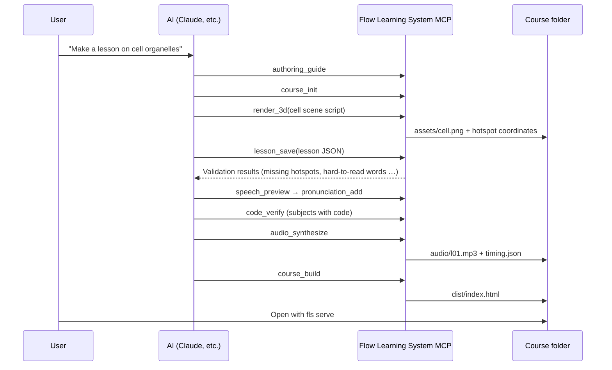

# Flow Learning System

<p align="center"><b>English</b> · <a href="README.ko.md">한국어</a> · <a href="README.ja.md">日本語</a> · <a href="README.zh-CN.md">简体中文</a></p>

**A learning system built on motion graphics and TTS.** It works for any subject: math, science, English, biology, programming, and more.
Write a lesson as JSON data and **each sentence becomes one scene**. The result is a single-file HTML textbook in which graphs, equations, sentence parts, 3D illustrations, and code move on screen the moment the voice starts reading the sentence they belong to.
An AI uses MCP tools to write the textbook, check it, run its example code to verify the output, render 3D illustrations with Blender, record the narration, and build it.
The bundled TTS (Supertonic) currently voices Korean and English, and the sample courses are in Korean.

<table>
<tr>
<td width="50%"><br><b>Math</b> · Translating a quadratic function<br><sub>The curve slides into its new position, and the changing part of the equation is highlighted</sub></td>
<td width="50%"><br><b>Science</b> · A block on an incline<br><sub>On top of a Blender render, gravity splits into two components that grow out of it</sub></td>
</tr>
<tr>
<td><br><b>English</b> · Forming the passive voice<br><sub>Words move to new positions, and example sentences are read by an English voice</sub></td>
<td><br><b>Biology</b> · Structure of the animal cell<br><sub>Zooms into a 3D cross-section of the cell, pointing out organelles one by one</sub></td>
</tr>
</table>

<p align="center"><br><b>Programming</b> · Lesson 7 (Arrays) of a 17-lesson C# syntax course — current-line highlighting, array cells filling in, an execution trace table, collapsible contents and script panels</p>

---

## Core idea: one sentence = one scene

<p align="center"></p>

- Each `say` in a lesson is **one scene**. A scene bundles the script sentence, a large key phrase, and the visuals for that moment (graph, equation, sentence parts, image, code, variables…).
- Narration is synthesized sentence by sentence and concatenated, and **the start time of each sentence** is recorded in `timing.json`.
- The player reads the audio's current playback position every frame and picks the scene from it. Changing the playback speed or jumping to the middle never puts the picture and the voice out of sync.

## Example courses

| Subject | Course | Scenes | Visuals used | What to look for |
|---|---|---|---|---|
| Math | [`examples/math-quadratic`](examples/math-quadratic) | 13 | `plot`, `math`, `tbl` | A curve with the same name morphs between scenes, so the translation is visible |
| Science | [`examples/physics-incline`](examples/physics-incline) | 12 | `img` (3D render), `math`, `bars`, `plot` | Arrows grow toward force endpoints computed in 3D; zoom |
| English | [`examples/english-passive`](examples/english-passive) | 12 | `tokens`, example-sentence panel, `tbl`, `flow` | Word chunks move to new positions; `{en|…}` segments use an English voice |
| Biology | [`examples/biology-cell`](examples/biology-cell) | 13 | `img` (3D render), `flow`, `cards` | Organelle labels move around as the view zooms into the cell cross-section |
| Programming | [`examples/csharp-grammar`](examples/csharp-grammar) | 321 (17 lessons) | Code, variables, arrays, stack/queue/dictionary, console | All 48 examples are actually run and compared against the on-screen output |

## Adding 3D illustrations with Blender

<p align="center"></p>

The `render_3d` tool runs an AI-written Blender scene script headlessly and renders it with Cycles.
When the script marks a 3D position with `spot("name", (x, y, z))`, the tool computes **where that point lands in the perspective-projected image** and saves it alongside the render.
Lessons then refer to those names for labels, zoom centers, and arrows.

```python
# Block on an incline — compute the endpoints of gravity and its two components as 3D vectors
th = math.radians(30)
d = V3((math.cos(th), 0, -math.sin(th)))   # down-slope direction
n = V3((math.sin(th), 0, math.cos(th)))    # normal to the incline
spot("block", C)
spot("g_tip", C + V3((0, 0, -2.6)))                 # gravity mg
spot("par_tip", C + d * 2.6 * math.sin(th))         # mg sinθ
spot("perp_tip", C - n * 2.6 * math.cos(th))        # mg cosθ
```

```json
{"img": ["assets/incline.png", {
  "spots": {"theta": {"label": "θ = 30°"}},
  "arrows": [{"from": "block", "to": "g_tip", "label": "mg", "c": "bad"},
             {"from": "block", "to": "par_tip", "label": "mg sinθ", "c": "g1"}],
  "zoom": 1.35, "focus": "block"}]}
```

Because the arrow tips are points computed in 3D, they line up exactly with the rendered incline. Scene scripts are kept in `assets/src/`, so they can be re-rendered at any time.

## Screen layout

<p align="center"></p>

| Area | Contents |
|---|---|
| Left: **Contents** | Lessons and sections. Collapsible; clicking a section jumps to that scene |
| Center: **Stage** | Key phrase + left panel (code or example sentences, with the current line highlighted) + visuals. Always dark, regardless of theme |
| Right: **Script** | About 1/5 of the screen. Highlights the sentence being read; clicking a sentence plays from there. Collapsible |
| Bottom: **Timeline** | Progress bar divided by scene |

The top bar holds only lesson navigation, play, scene navigation, and playback speed (0.75×–2×). On phones, the contents and script panels become drawers that open over the stage.

## Motion rules

<p align="center"></p>

When the scene changes, on-screen elements are **matched by name (key)** and animated. No animation needs to be specified separately: changing the data is enough to produce motion.

| Motion | When | Example |
|---|---|---|
| Slide | An element with the same name is in a different position | Array sorting, pointer `i`, words moving in the passive voice |
| Morph | The coordinates of a curve, point, or line with the same name change | Translating a parabola, changing its width |
| Fly in | A source cell is given with `from` | `answer[(i + k) % n] = arr[i]` |
| Grow | A new arrow appears | Resolving a force into components |
| Zoom / pan | An image's `zoom` or `focus` changes | Pointing out cell organelles |
| Blink · Scatter | Only the value changes · element disappears | Variable values, Pop |

## Anatomy of a lesson

<p align="center"></p>

```json
{
  "id": 1, "group": "수학", "title": "이차함수의 평행이동",
  "ops": [
    {"op": "part", "title": "x축 방향으로 평행이동"},
    {"op": "say", "head": "{m|y = (x - 2)^2} : 오른쪽으로 2",
     "text": "x 자리에 x 빼기 2를 넣으면 그래프 전체가 오른쪽으로 2만큼 미끄러집니다.",
     "board": {"seq": [
       {"plot": [{"curves": [{"fn": "(x-2)**2", "c": "g1", "key": "p"}],
                  "points": [{"x": 2, "y": 0, "label": "꼭짓점 (2, 0)", "key": "v"}]}]},
       {"math": [["y = x^2", "y = (x - 2)^2"], {"hl": [1]}]}]}}
  ]
}
```

The sample courses are narrated in Korean; `{en|…}` segments switch to an English voice.

The ops before a `say` build up the screen state, and the `say` captures that moment, together with its sentence, as a scene.
The 22 ops, 24 widgets, and sentence markup (`{m|equation}`, `{en|English}`, `[[written form|spoken form]]`) are documented in the **[authoring guide](docs/authoring.md)** (in Korean). The MCP `authoring_guide` tool returns the same content.

## Workflow

<p align="center"></p>



What the checks catch:

- **Validation**: unknown ops or widgets, hotspots that don't exist in the image, scenes that try to highlight lines not in the code, English words the TTS can't read
- **Code verification**: actually compiles and runs each example and compares it character by character with the on-screen console output (C#: Mono or .NET SDK; Python)
- **Reading preview**: `17개` → 열일곱 개 (native Korean counting), `19.6` → 십구 점 육 (Sino-Korean "nineteen point six"), `8분의 1` → 팔분의 일 ("one eighth"), `{en|…}` → English voice

## Installation

```bash
git clone https://github.com/ghlee0786/flow-learning-system.git
cd flow-learning-system
pip install -e ".[tts]"
```

| Requirement | Used for | Without it |
|---|---|---|
| Python 3.10+ | Everything | — |
| [Supertonic](https://github.com/supertone-inc/supertonic) (`[tts]`) | Korean and English speech synthesis. Downloads the model from Hugging Face on first run | The textbook runs without audio, using estimated timings |
| ffmpeg | Saving as mp3 | Saves as wav |
| [Blender](https://www.blender.org/) 3.6+ | `render_3d` | Only 3D illustrations are unavailable. If it is not on PATH, set `FLS_BLENDER` to the executable path |
| Mono or .NET SDK | Verifying C# examples | Only C# verification is skipped |

## Registering the MCP server

There is no need to keep the MCP server running. Register it once with your client, and the AI launches it on its own whenever it uses a tool (stdio).

**Claude Code**

```bash
claude mcp add flow-learning-system -- python -m flow_learning_system.server
```

**Claude Desktop** (`claude_desktop_config.json`)

```json
{
  "mcpServers": {
    "flow-learning-system": {
      "command": "python",
      "args": ["-m", "flow_learning_system.server"],
      "env": { "FLS_BLENDER": "C:\\Program Files\\Blender Foundation\\Blender 4.2\\blender.exe" }
    }
  }
}
```

On Windows, if `python` points to a different environment, use the full path to `python.exe` in the virtual environment where you installed the package.

### Tools (13)

| Tool | What it does |
|---|---|
| `authoring_guide` | Lesson format, widgets, motion rules, how to write sentences |
| `course_init` / `course_status` | Create a new course / per-lesson scene count, issue count, and audio status |
| `lesson_get` / `lesson_save` | Read a lesson / validate and save it (not saved if there are errors) |
| `lesson_validate` | Validation |
| `render_3d` | Blender scene script → image + hotspot coordinates |
| `assets_list` | The course's images and their hotspot names and coordinates |
| `speech_preview` | The exact sentences the TTS will read for each scene |
| `pronunciation_add` | Register Hangul readings for English words |
| `code_verify` | Check that example code output matches the on-screen console output |
| `audio_synthesize` | Lesson audio and timing table (changed lessons only) |
| `course_build` | `dist/index.html` + audio + images |

## Command line

```bash
fls validate examples/biology-cell              # validation
fls render   examples/biology-cell --name cell --script scene.py   # Blender render
fls speech   examples/english-passive --lesson 1   # TTS reading preview
fls verify   examples/csharp-grammar            # run and verify example code
fls audio    examples/math-quadratic            # speech synthesis
fls build    examples/math-quadratic            # dist/index.html
fls serve    examples/math-quadratic            # open locally (also from phones on the same Wi-Fi)
fls all      examples/physics-incline           # validate → verify → audio → build
```

A built textbook consists only of `index.html` plus the `audio/` and `assets/` folders, so it works without a server. It can be uploaded as-is to static hosting such as GitHub Pages.
Audio files are not included in the repository. Generate them with `fls audio <course>`.

## Folder structure

```
src/flow_learning_system/
  server.py      MCP server (13 tools)
  cli.py         fls command
  lesson.py      Lesson ops interpretation · validation (same rules as the player)
  speech.py      Script → TTS sentences (code-term readings, Korean number reading, English segments)
  tts.py         Supertonic synthesis · per-sentence timing · cache
  render.py      Blender rendering · hotspot projection
  verify.py      Example code execution (C#: Mono/.NET, Python)
  build.py       Single-file HTML build
  guide.md       Lesson authoring guide
  player/        Player (core.js equations/graphics, lesson.js scene builder/widgets, interp.js JSON interpretation, app.js playback/sync/motion)
examples/                  Math · science · English · biology · C# example courses (3D scene scripts in assets/src/)
docs/                      Authoring guide, README figures
tools/                     README figure generators, legacy JS lesson converter
tests/                     pytest
```

## License

MIT. The Supertonic Python package used for speech synthesis is MIT-licensed and its model is under the OpenRAIL license; neither is included in this repository (the model is downloaded on first run).
