# Flow Learning System

**모션 그래픽과 TTS를 활용한 학습 시스템.** 수학, 과학, 영어, 생명과학, 프로그래밍 등 과목을 가리지 않습니다.
레슨을 JSON 데이터로 쓰면 **문장 하나가 장면 하나**가 되고, 음성이 그 문장을 읽기 시작하는 순간
화면의 그래프·수식·문장 성분·3D 그림·코드가 함께 움직이는 한 파일짜리 HTML 교재가 만들어집니다.
AI는 MCP 도구로 교재를 쓰고, 검사하고, 예제 코드를 실행해 확인하고, Blender로 3D 그림을 렌더하고, 녹음하고, 빌드합니다.

<table>
<tr>
<td width="50%">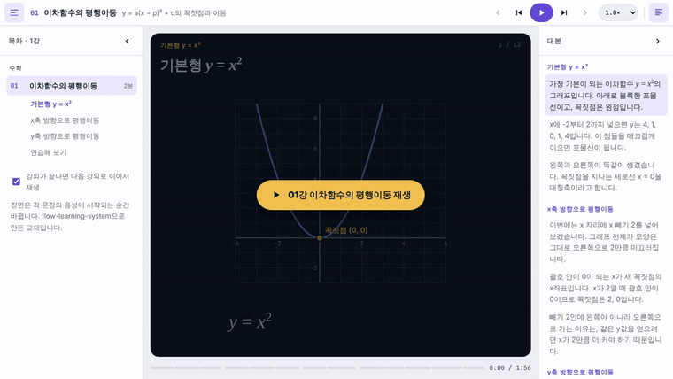<br><b>수학</b> · 이차함수의 평행이동<br><sub>곡선이 미끄러지며 이동하고, 수식의 바뀌는 부분이 강조됩니다</sub></td>
<td width="50%">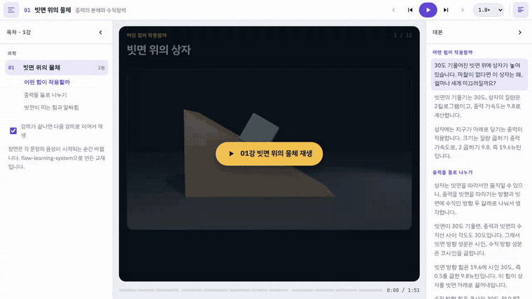<br><b>과학</b> · 빗면 위의 물체<br><sub>Blender 렌더 위에서 중력이 두 성분으로 나뉘어 자라납니다</sub></td>
</tr>
<tr>
<td>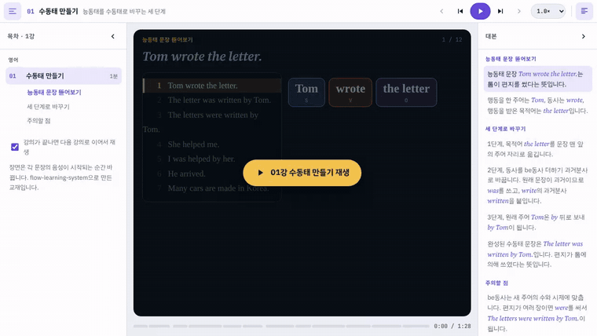<br><b>영어</b> · 수동태 만들기<br><sub>낱말이 자리를 옮기고, 예문은 영어 음성으로 읽습니다</sub></td>
<td>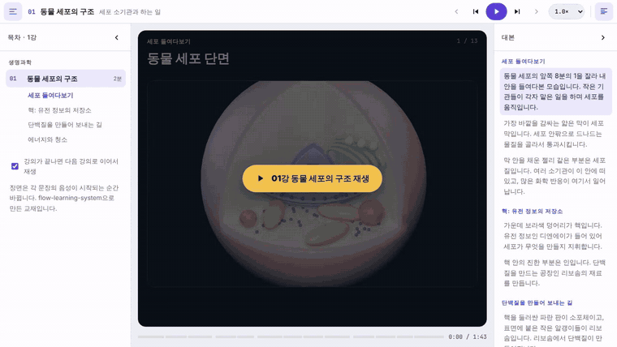<br><b>생명과학</b> · 동물 세포의 구조<br><sub>3D 세포 단면을 확대하며 소기관을 하나씩 짚습니다</sub></td>
</tr>
</table>

<p align="center">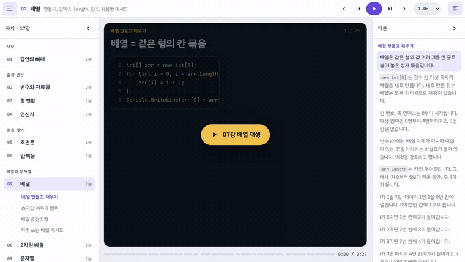<br><b>프로그래밍</b> · C# 문법 17강 중 7강 배열 — 실행 중인 줄 강조, 배열 칸 채우기, 실행 기록 표, 목차·대본 접기</p>

---

## 핵심 아이디어: 문장 하나 = 장면 하나

<p align="center"></p>

- 레슨의 `say` 하나가 **장면 하나**입니다. 장면에는 대본 문장, 큰 핵심 문구, 그 순간의 그림(그래프, 수식, 문장 성분, 이미지, 코드, 변수…)이 함께 들어 있습니다.
- 음성은 문장마다 따로 합성해 이어 붙이고, **각 문장이 몇 초에 시작하는지**를 `timing.json`에 기록합니다.
- 플레이어는 오디오의 현재 재생 위치를 매 프레임 읽어 장면을 고릅니다. 배속을 바꾸거나 중간으로 건너뛰어도 화면과 음성이 어긋나지 않습니다.

## 예제 코스

| 과목 | 코스 | 장면 | 쓰인 그림 | 볼거리 |
|---|---|---|---|---|
| 수학 | [`examples/math-quadratic`](examples/math-quadratic) | 13 | `plot`, `math`, `tbl` | 같은 이름의 곡선이 장면 사이에 변형되어 평행이동이 눈에 보임 |
| 과학 | [`examples/physics-incline`](examples/physics-incline) | 12 | `img`(3D 렌더), `math`, `bars`, `plot` | 3D에서 계산한 힘의 끝점으로 화살표가 늘어남, 확대 |
| 영어 | [`examples/english-passive`](examples/english-passive) | 12 | `tokens`, 예문 칸, `tbl`, `flow` | 낱말 덩어리가 자리를 옮김, `{en|…}` 구간은 영어 음성 |
| 생명과학 | [`examples/biology-cell`](examples/biology-cell) | 13 | `img`(3D 렌더), `flow`, `cards` | 세포 단면을 확대하며 소기관 이름표가 옮겨 다님 |
| 프로그래밍 | [`examples/csharp-grammar`](examples/csharp-grammar) | 321 (17강) | 코드, 변수, 배열, 스택·큐·사전, 콘솔 | 예제 48개를 실제로 실행해 화면 출력과 비교 |

## Blender로 3D 그림 넣기

<p align="center">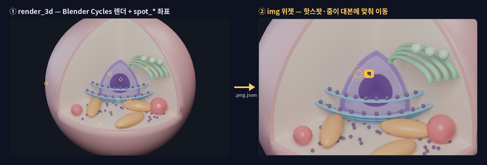</p>

`render_3d` 도구는 AI가 쓴 Blender 장면 스크립트를 창 없이 실행해 Cycles로 렌더합니다.
스크립트에서 `spot("이름", (x, y, z))`로 3D 위치를 찍어 두면, 그 점이 **원근이 반영된 이미지의 어디에 찍히는지** 계산해 함께 저장합니다.
레슨은 그 이름으로 이름표, 확대 중심, 화살표를 지정합니다.

```python
# 빗면 위 상자 — 중력과 두 성분의 끝점을 3D 벡터로 계산
th = math.radians(30)
d = V3((math.cos(th), 0, -math.sin(th)))   # 빗면 아래 방향
n = V3((math.sin(th), 0, math.cos(th)))    # 빗면 수직 방향
spot("block", C)
spot("g_tip", C + V3((0, 0, -2.6)))                 # 중력 mg
spot("par_tip", C + d * 2.6 * math.sin(th))         # mg sinθ
spot("perp_tip", C - n * 2.6 * math.cos(th))        # mg cosθ
```

```json
{"img": ["assets/incline.png", {
  "spots": {"theta": {"label": "θ = 30°"}},
  "arrows": [{"from": "block", "to": "g_tip", "label": "mg", "c": "bad"},
             {"from": "block", "to": "par_tip", "label": "mg sinθ", "c": "g1"}],
  "zoom": 1.35, "focus": "block"}]}
```

화살표 끝이 3D에서 계산한 점이라, 렌더된 빗면과 정확히 맞습니다. 장면 스크립트는 `assets/src/`에 남아 언제든 다시 렌더할 수 있습니다.

## 화면 구성

<p align="center">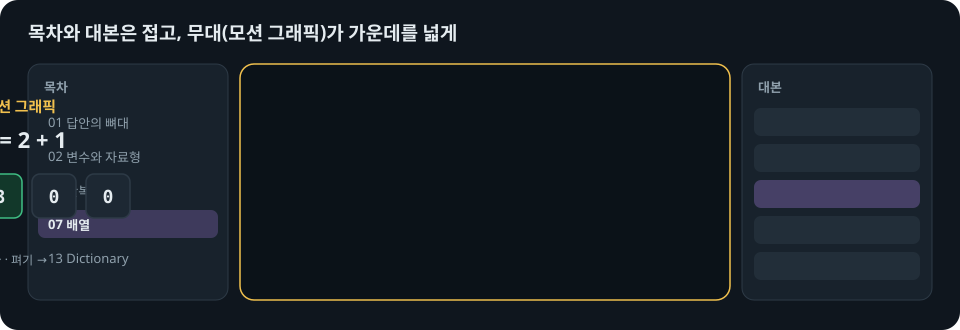</p>

| 영역 | 내용 |
|---|---|
| 왼쪽 **목차** | 강의와 소단원. 접을 수 있고, 소단원을 누르면 그 장면으로 이동 |
| 가운데 **무대** | 핵심 문구 + 왼쪽 칸(코드·예문, 지금 줄 강조) + 그림. 테마와 무관하게 늘 어두운 화면 |
| 오른쪽 **대본** | 화면의 약 1/5. 읽는 문장 강조, 누르면 그 문장부터 재생. 접을 수 있음 |
| 아래 **타임라인** | 장면 단위로 나뉜 진행 막대 |

상단 바에는 강의 이동, 재생, 장면 이동, 배속(0.75×~2×)만 둡니다. 휴대폰에서는 목차와 대본이 겹쳐 열리는 서랍이 됩니다.

## 모션 규칙

<p align="center"></p>

장면이 바뀔 때 화면 요소를 **이름(키)으로 짝지어** 움직입니다. 애니메이션을 따로 지정하지 않아도, 데이터만 바꾸면 움직임이 생깁니다.

| 움직임 | 언제 | 예 |
|---|---|---|
| 미끄러짐 | 같은 이름의 요소가 다른 자리에 있을 때 | 배열 정렬, 포인터 `i`, 수동태에서 낱말 이동 |
| 변형 | 같은 이름의 곡선·점·선의 좌표가 바뀔 때 | 포물선 평행이동, 폭 변화 |
| 날아옴 | `from`으로 출발 칸을 지정했을 때 | `answer[(i + k) % n] = arr[i]` |
| 늘어남 | 새 화살표가 생길 때 | 힘의 분해 |
| 확대·이동 | 이미지의 `zoom`, `focus`가 바뀔 때 | 세포 소기관 짚기 |
| 깜빡임 · 흩어짐 | 값만 바뀜 · 사라짐 | 변수 값, Pop |

## 레슨 하나의 해부도

<p align="center">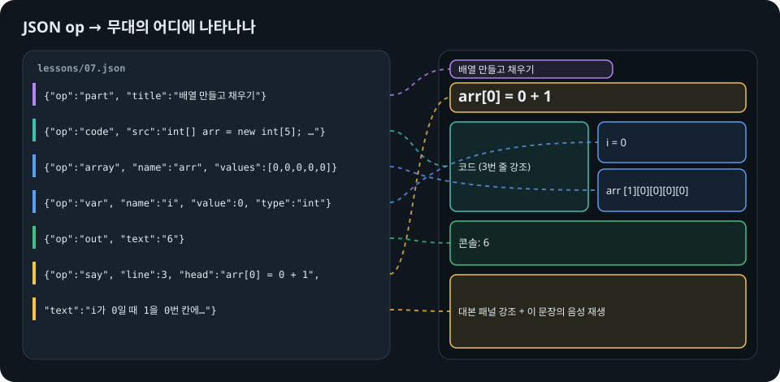</p>

```json
{
  "id": 1, "group": "수학", "title": "이차함수의 평행이동",
  "ops": [
    {"op": "part", "title": "x축 방향으로 평행이동"},
    {"op": "say", "head": "{m|y = (x - 2)^2} : 오른쪽으로 2",
     "text": "x 자리에 x 빼기 2를 넣으면 그래프 전체가 오른쪽으로 2만큼 미끄러집니다.",
     "board": {"seq": [
       {"plot": [{"curves": [{"fn": "(x-2)**2", "c": "g1", "key": "p"}],
                  "points": [{"x": 2, "y": 0, "label": "꼭짓점 (2, 0)", "key": "v"}]}]},
       {"math": [["y = x^2", "y = (x - 2)^2"], {"hl": [1]}]}]}}
  ]
}
```

`say` 앞의 op들이 화면 상태를 만들고, `say`가 그 순간을 문장과 함께 장면으로 찍어 둡니다.
op 22종, 위젯 24종, 문장 표기법(`{m|수식}`, `{en|English}`, `[[표기|읽는 말]]`)은 **[레슨 작성 가이드](docs/authoring.md)** 에 있습니다. MCP의 `authoring_guide` 도구도 같은 내용을 돌려줍니다.

## 작업 흐름

<p align="center"></p>

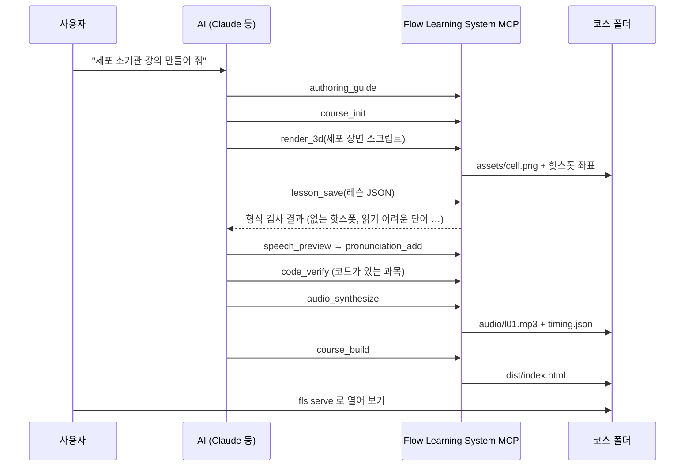

검사 단계가 잡아 주는 것들:

- **형식 검사**: 없는 op·위젯, 이미지에 없는 핫스폿, 코드에 없는 줄을 강조하려는 장면, TTS가 못 읽을 영어 단어
- **코드 확인**: 예제를 실제로 컴파일·실행해 화면의 콘솔 출력과 한 글자까지 비교(C#: Mono 또는 .NET SDK, Python)
- **읽기 미리 보기**: `17개` → 열일곱 개, `19.6` → 십구 점 육, `8분의 1` → 팔분의 일, `{en|…}` → 영어 음성

## 설치

```bash
git clone https://github.com/ghlee0786/flow-learning-system.git
cd flow-learning-system
pip install -e ".[tts]"
```

| 필요한 것 | 용도 | 없으면 |
|---|---|---|
| Python 3.10+ | 전체 | — |
| [Supertonic](https://github.com/supertone-inc/supertonic) (`[tts]`) | 한국어·영어 음성 합성. 첫 실행 때 모델을 Hugging Face에서 내려받음 | 음성 없이 예상 시간으로 진행하는 교재 |
| ffmpeg | mp3로 저장 | wav로 저장 |
| [Blender](https://www.blender.org/) 3.6+ | `render_3d` | 3D 그림만 못 만듦. PATH에 없으면 `FLS_BLENDER`에 실행 파일 경로 |
| Mono 또는 .NET SDK | C# 예제 확인 | C# 확인만 건너뜀 |

## MCP 서버 등록

MCP 서버는 따로 켜 둘 필요가 없습니다. 클라이언트에 한 번 등록해 두면, AI가 도구를 쓸 때 알아서 실행합니다(stdio).

**Claude Code**

```bash
claude mcp add flow-learning-system -- python -m flow_learning_system.server
```

**Claude Desktop** (`claude_desktop_config.json`)

```json
{
  "mcpServers": {
    "flow-learning-system": {
      "command": "python",
      "args": ["-m", "flow_learning_system.server"],
      "env": { "FLS_BLENDER": "C:\\Program Files\\Blender Foundation\\Blender 4.2\\blender.exe" }
    }
  }
}
```

Windows에서 `python`이 다른 환경을 가리키면, 설치한 가상환경의 `python.exe` 전체 경로를 적으세요.

### 도구 (13개)

| 도구 | 하는 일 |
|---|---|
| `authoring_guide` | 레슨 형식, 위젯, 모션 규칙, 문장 쓰는 법 |
| `course_init` / `course_status` | 새 코스 만들기 / 레슨별 장면 수·문제 수·음성 상태 |
| `lesson_get` / `lesson_save` | 레슨 읽기 / 검사 후 저장(오류가 있으면 저장하지 않음) |
| `lesson_validate` | 형식 검사 |
| `render_3d` | Blender 장면 스크립트 → 이미지 + 핫스폿 좌표 |
| `assets_list` | 코스의 이미지와 핫스폿 이름·좌표 |
| `speech_preview` | 장면마다 TTS가 실제로 읽을 문장 |
| `pronunciation_add` | 영어 단어의 한글 읽기 등록 |
| `code_verify` | 예제 코드 실행 결과 = 화면 콘솔 출력인지 확인 |
| `audio_synthesize` | 레슨 음성과 시각표(바뀐 레슨만) |
| `course_build` | `dist/index.html` + 음성 + 이미지 |

## 명령줄

```bash
fls validate examples/biology-cell              # 형식 검사
fls render   examples/biology-cell --name cell --script scene.py   # Blender 렌더
fls speech   examples/english-passive --lesson 1   # TTS 읽기 미리 보기
fls verify   examples/csharp-grammar            # 예제 코드 실행 확인
fls audio    examples/math-quadratic            # 음성 합성
fls build    examples/math-quadratic            # dist/index.html
fls serve    examples/math-quadratic            # 로컬에서 열기 (같은 와이파이의 휴대폰도)
fls all      examples/physics-incline           # 검사 → 확인 → 음성 → 빌드
```

만들어진 교재는 `index.html`과 `audio/`, `assets/` 폴더뿐이라 서버 없이 동작합니다. GitHub Pages 같은 정적 호스팅에 그대로 올릴 수 있습니다.
음성 파일은 저장소에 넣지 않았습니다. `fls audio <코스>`로 만들 수 있습니다.

## 폴더 구조

```
src/flow_learning_system/
  server.py      MCP 서버 (도구 13개)
  cli.py         fls 명령
  lesson.py      레슨 ops 해석 · 형식 검사 (플레이어와 같은 규칙)
  speech.py      대본 → TTS 문장 (코드 용어 읽기, 한국어 수 읽기, 영어 구간)
  tts.py         Supertonic 합성 · 문장별 시각표 · 캐시
  render.py      Blender 렌더 · 핫스폿 투영
  verify.py      예제 코드 실행 (C#: Mono/.NET, Python)
  build.py       한 파일짜리 HTML 빌드
  guide.md       레슨 작성 가이드
  player/        플레이어 (core.js 수식·그림, lesson.js 장면 빌더·위젯, interp.js JSON 해석, app.js 재생·동기화·모션)
examples/                  수학 · 과학 · 영어 · 생명과학 · C# 예제 코스 (3D 장면 스크립트는 assets/src/)
docs/                      작성 가이드, README 그림
tools/                     README 그림 생성기, 예전 JS 레슨 변환기
tests/                     pytest
```

## 라이선스

MIT. 음성 합성에 쓰는 Supertonic 파이썬 패키지는 MIT, 모델은 OpenRAIL 라이선스이며 이 저장소에는 포함되어 있지 않습니다(첫 실행 때 내려받음).
