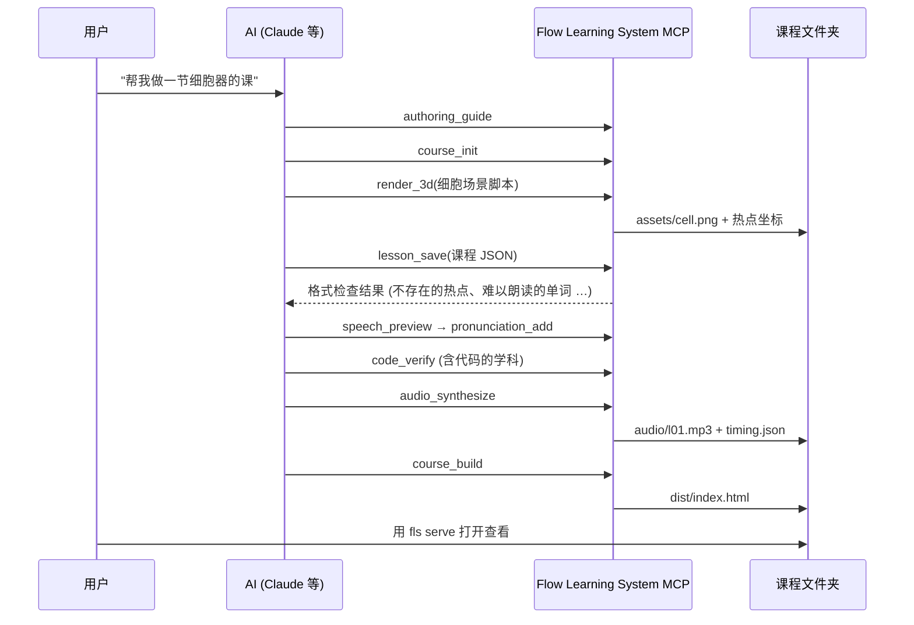

# Flow Learning System
<p align="center"><a href="README.md">English</a> · <a href="README.ko.md">한국어</a> · <a href="README.ja.md">日本語</a> · <b>简体中文</b></p>

**一个结合动态图形与 TTS 的学习系统。** 数学、科学、英语、生命科学、编程等，不限学科。
把课程写成 JSON 数据后，**每一句话就是一个场景**；语音开始朗读某句话的那一刻，
画面上的图像、公式、句子成分、3D 图示和代码也随之运动，最终生成一个单文件 HTML 教材。
AI 通过 MCP 工具编写教材、检查格式、运行示例代码进行验证、用 Blender 渲染 3D 图示、录制语音并完成构建。

内置的 TTS（Supertonic）目前支持韩语和英语配音，示例课程均为韩语。

<table>
<tr>
<td width="50%"><br><b>数学</b> · 二次函数的平移<br><sub>曲线滑动平移，公式中发生变化的部分被高亮</sub></td>
<td width="50%"><br><b>科学</b> · 斜面上的物体<br><sub>在 Blender 渲染图上，重力分解为两个分量并逐渐伸长</sub></td>
</tr>
<tr>
<td><br><b>英语</b> · 构造被动语态<br><sub>单词移动位置，例句用英语语音朗读</sub></td>
<td><br><b>生命科学</b> · 动物细胞的结构<br><sub>放大 3D 细胞剖面，逐一指出各个细胞器</sub></td>
</tr>
</table>

<p align="center"><br><b>编程</b> · C# 语法 17 讲中的第 7 讲“数组”——高亮正在执行的行、填充数组格子、执行记录表、可折叠的目录与讲稿</p>

---

## 核心思想：一句话 = 一个场景

<p align="center"></p>

- 课程中的每个 `say` 就是**一个场景**。场景包含讲稿句子、醒目的核心短语，以及该时刻的图示（图像、公式、句子成分、图片、代码、变量……）。
- 语音按句分别合成后拼接，并把**每句话从第几秒开始**记录在 `timing.json` 中。
- 播放器每一帧读取音频的当前播放位置来选择场景。即使改变倍速或跳到中间，画面与语音也不会错位。

## 示例课程

| 学科 | 课程 | 场景数 | 使用的图示 | 看点 |
|---|---|---|---|---|
| 数学 | [`examples/math-quadratic`](examples/math-quadratic) | 13 | `plot`, `math`, `tbl` | 同名曲线在场景之间变形，平移过程一目了然 |
| 科学 | [`examples/physics-incline`](examples/physics-incline) | 12 | `img`（3D 渲染）, `math`, `bars`, `plot` | 箭头伸长到在 3D 中计算出的力的端点，并配合放大 |
| 英语 | [`examples/english-passive`](examples/english-passive) | 12 | `tokens`、例句栏、`tbl`, `flow` | 词块移动位置，`{en|…}` 片段使用英语语音 |
| 生命科学 | [`examples/biology-cell`](examples/biology-cell) | 13 | `img`（3D 渲染）, `flow`, `cards` | 放大细胞剖面，细胞器标签随之移动 |
| 编程 | [`examples/csharp-grammar`](examples/csharp-grammar) | 321（17 讲） | 代码、变量、数组、栈·队列·字典、控制台 | 实际运行 48 个示例，并与画面上的输出对比 |

## 用 Blender 加入 3D 图示

<p align="center"></p>

`render_3d` 工具以无窗口方式运行 AI 编写的 Blender 场景脚本，并用 Cycles 渲染。
在脚本中用 `spot("名称", (x, y, z))` 标记 3D 位置后，系统会计算该点**在带透视的图像上落在何处**，并一并保存。
课程通过这些名称来指定标签、放大中心和箭头。

```python
# 斜面上的方块——用 3D 向量计算重力及其两个分量的端点
th = math.radians(30)
d = V3((math.cos(th), 0, -math.sin(th)))   # 沿斜面向下方向
n = V3((math.sin(th), 0, math.cos(th)))    # 垂直于斜面方向
spot("block", C)
spot("g_tip", C + V3((0, 0, -2.6)))                 # 重力 mg
spot("par_tip", C + d * 2.6 * math.sin(th))         # mg sinθ
spot("perp_tip", C - n * 2.6 * math.cos(th))        # mg cosθ
```

```json
{"img": ["assets/incline.png", {
  "spots": {"theta": {"label": "θ = 30°"}},
  "arrows": [{"from": "block", "to": "g_tip", "label": "mg", "c": "bad"},
             {"from": "block", "to": "par_tip", "label": "mg sinθ", "c": "g1"}],
  "zoom": 1.35, "focus": "block"}]}
```

箭头端点是在 3D 中计算出的点，因此与渲染出的斜面精确吻合。场景脚本保留在 `assets/src/` 中，随时可以重新渲染。

## 界面布局

<p align="center"></p>

| 区域 | 内容 |
|---|---|
| 左侧 **目录** | 讲次与小节。可折叠，点击小节即跳转到对应场景 |
| 中间 **舞台** | 核心短语 + 左栏（代码·例句，高亮当前行）+ 图示。无论主题如何，始终为深色背景 |
| 右侧 **讲稿** | 约占画面的 1/5。高亮正在朗读的句子，点击即从该句开始播放。可折叠 |
| 底部 **时间轴** | 按场景分段的进度条 |

顶栏只保留讲次切换、播放、场景切换和倍速（0.75×~2×）。在手机上，目录和讲稿会变成叠加展开的抽屉。

## 动效规则

<p align="center"></p>

切换场景时，画面元素**按名称（键）配对**后进行运动。无需单独指定动画，只要修改数据就会产生动效。

| 动效 | 触发时机 | 示例 |
|---|---|---|
| 滑动 | 同名元素出现在不同位置时 | 数组排序、指针 `i`、被动语态中的单词移动 |
| 变形 | 同名曲线·点·线的坐标发生变化时 | 抛物线平移、开口宽度变化 |
| 飞入 | 用 `from` 指定起始格子时 | `answer[(i + k) % n] = arr[i]` |
| 伸长 | 出现新箭头时 | 力的分解 |
| 放大·平移 | 图片的 `zoom`、`focus` 发生变化时 | 逐一指出细胞器 |
| 闪烁 · 消散 | 仅值改变 · 元素消失 | 变量值、Pop |

## 一节课程的解剖图

<p align="center"></p>

```json
{
  "id": 1, "group": "수학", "title": "이차함수의 평행이동",
  "ops": [
    {"op": "part", "title": "x축 방향으로 평행이동"},
    {"op": "say", "head": "{m|y = (x - 2)^2} : 오른쪽으로 2",
     "text": "x 자리에 x 빼기 2를 넣으면 그래프 전체가 오른쪽으로 2만큼 미끄러집니다.",
     "board": {"seq": [
       {"plot": [{"curves": [{"fn": "(x-2)**2", "c": "g1", "key": "p"}],
                  "points": [{"x": 2, "y": 0, "label": "꼭짓점 (2, 0)", "key": "v"}]}]},
       {"math": [["y = x^2", "y = (x - 2)^2"], {"hl": [1]}]}]}}
  ]
}
```

注：示例课程以韩语讲解，`{en|…}` 片段使用英语语音朗读。

`say` 之前的 op 负责构建画面状态，`say` 则把这一刻连同句子记录为一个场景。
22 种 op、24 种控件以及句子标记法（`{m|公式}`、`{en|English}`、`[[写法|读法]]`）详见 **[课程编写指南](docs/authoring.md)**（韩语撰写）。MCP 的 `authoring_guide` 工具也会返回相同内容。

## 工作流程

<p align="center"></p>



检查阶段能发现的问题：

- **格式检查**：不存在的 op·控件、图片中不存在的热点、要高亮代码中不存在的行的场景、TTS 无法朗读的英语单词
- **代码验证**：实际编译·运行示例，并与画面上的控制台输出逐字比对（C#：Mono 或 .NET SDK；Python）
- **朗读预览**（韩语数字读法）：`17개` → 열일곱 개（“十七个”，固有词读法），`19.6` → 십구 점 육（“十九点六”），`8분의 1` → 팔분의 일（“八分之一”），`{en|…}` → 英语语音

## 安装

```bash
git clone https://github.com/ghlee0786/flow-learning-system.git
cd flow-learning-system
pip install -e ".[tts]"
```

| 依赖 | 用途 | 缺失时 |
|---|---|---|
| Python 3.10+ | 全部 | — |
| [Supertonic](https://github.com/supertone-inc/supertonic) (`[tts]`) | 韩语·英语语音合成。首次运行时从 Hugging Face 下载模型 | 生成无语音、按预估时长推进的教材 |
| ffmpeg | 保存为 mp3 | 保存为 wav |
| [Blender](https://www.blender.org/) 3.6+ | `render_3d` | 仅无法生成 3D 图示。若不在 PATH 中，请在 `FLS_BLENDER` 中填写可执行文件路径 |
| Mono 或 .NET SDK | C# 示例验证 | 仅跳过 C# 验证 |

## 注册 MCP 服务器

MCP 服务器无需单独启动。只需在客户端注册一次，AI 使用工具时会自动运行它（stdio）。

**Claude Code**

```bash
claude mcp add flow-learning-system -- python -m flow_learning_system.server
```

**Claude Desktop**（`claude_desktop_config.json`）

```json
{
  "mcpServers": {
    "flow-learning-system": {
      "command": "python",
      "args": ["-m", "flow_learning_system.server"],
      "env": { "FLS_BLENDER": "C:\\Program Files\\Blender Foundation\\Blender 4.2\\blender.exe" }
    }
  }
}
```

在 Windows 上，如果 `python` 指向其他环境，请填写所安装虚拟环境中 `python.exe` 的完整路径。

### 工具（13 个）

| 工具 | 功能 |
|---|---|
| `authoring_guide` | 课程格式、控件、动效规则、句子写法 |
| `course_init` / `course_status` | 新建课程 / 各课程的场景数·问题数·语音状态 |
| `lesson_get` / `lesson_save` | 读取课程 / 检查后保存（有错误时不保存） |
| `lesson_validate` | 格式检查 |
| `render_3d` | Blender 场景脚本 → 图片 + 热点坐标 |
| `assets_list` | 课程中的图片及热点名称·坐标 |
| `speech_preview` | 每个场景中 TTS 实际朗读的句子 |
| `pronunciation_add` | 登记英语单词的韩文读法等 |
| `code_verify` | 验证示例代码运行结果是否等于画面上的控制台输出 |
| `audio_synthesize` | 课程语音与时间表（仅限有改动的课程） |
| `course_build` | `dist/index.html` + 语音 + 图片 |

## 命令行

```bash
fls validate examples/biology-cell              # 格式检查
fls render   examples/biology-cell --name cell --script scene.py   # Blender 渲染
fls speech   examples/english-passive --lesson 1   # TTS 朗读预览
fls verify   examples/csharp-grammar            # 验证示例代码运行结果
fls audio    examples/math-quadratic            # 语音合成
fls build    examples/math-quadratic            # dist/index.html
fls serve    examples/math-quadratic            # 本地打开（同一 Wi-Fi 下的手机也可访问）
fls all      examples/physics-incline           # 检查 → 验证 → 语音 → 构建
```

生成的教材只包含 `index.html` 以及 `audio/`、`assets/` 文件夹，无需服务器即可运行，可直接部署到 GitHub Pages 等静态托管服务。
语音文件未纳入仓库，可通过 `fls audio <课程>` 生成。

## 目录结构

```
src/flow_learning_system/
  server.py      MCP 服务器（13 个工具）
  cli.py         fls 命令
  lesson.py      课程 ops 解析 · 格式检查（与播放器规则一致）
  speech.py      讲稿 → TTS 句子（代码术语读法、韩语数字读法、英语片段）
  tts.py         Supertonic 合成 · 逐句时间表 · 缓存
  render.py      Blender 渲染 · 热点投影
  verify.py      示例代码运行（C#：Mono/.NET；Python）
  build.py       单文件 HTML 构建
  guide.md       课程编写指南
  player/        播放器（core.js 公式·图示，lesson.js 场景构建器·控件，interp.js JSON 解析，app.js 播放·同步·动效）
examples/                  数学 · 科学 · 英语 · 生命科学 · C# 示例课程（3D 场景脚本位于 assets/src/）
docs/                      编写指南、README 图片
tools/                     README 图片生成器、旧版 JS 课程转换器
tests/                     pytest
```

## 许可证

MIT。语音合成所用的 Supertonic Python 包采用 MIT 许可证，模型采用 OpenRAIL 许可证，二者均未包含在本仓库中（首次运行时下载）。
